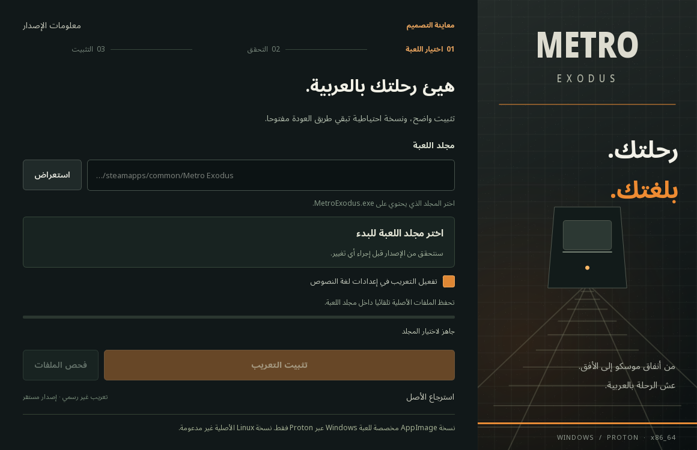

# تعريب Metro Exodus

تعريب عربي غير رسمي مع مثبت بواجهة عربية، وفحص للإصدار، ونسخة احتياطية واسترجاع.
يدعم إصدار Steam الخاص بـWindows، ونسخته العاملة عبر Proton على Linux وSteam Deck.

## التنزيل

| النظام | الملف |
|---|---|
| Windows x86_64 | [مثبت EXE](https://github.com/exelight7/metro-exodus-arabic/releases/download/v0.2.0-beta.2/Metro-Arabic-Installer-Windows.exe) |
| Linux وSteam Deck — لعبة Windows عبر Proton | [مثبت AppImage](https://github.com/exelight7/metro-exodus-arabic/releases/download/v0.2.0-beta.2/Metro-Arabic-Installer-Proton-x86_64.AppImage) |
| المصدر والفروقات | [المشروع كاملًا ZIP](https://github.com/exelight7/metro-exodus-arabic/releases/download/v0.2.0-beta.2/Metro-Exodus-Arabic-v0.2.0-beta.2-Full-Project.zip) |
| التحقق من التنزيل | [SHA256SUMS.txt](https://github.com/exelight7/metro-exodus-arabic/releases/download/v0.2.0-beta.2/SHA256SUMS.txt) |

**[صفحة الإصدار](https://github.com/exelight7/metro-exodus-arabic/releases/tag/v0.2.0-beta.2) · [شرح التثبيت وProton](docs/INSTALLATION_AR.md)**

## التثبيت

أغلق اللعبة، وافتح المثبت، وحدد مجلد `MetroExodus.exe`، ثم افحص الملفات وثبت التعريب.
اختر English للغة النصوص إن لم تفعل تلقائيًا. يحفظ التطبيق نسخة من الأصل، ويتيح
استرجاعها من الواجهة. إعداد الصوت وملفات الحفظ لا يتغيران.

**AppImage مخصصة لتثبيت التعريب على نسخة Windows عبر Proton. نسخة اللعبة الأصلية
الخاصة بـLinux وEnhanced Edition غير مدعومتين.** شرح اختيار Proton والتشغيل على
Steam Deck وحل عدم توفر FUSE موجود في [دليل التثبيت](docs/INSTALLATION_AR.md).

## محتويات المشروع

- الحزمة الحالية: `final_review_r1` مع إصلاح نص التحميل `loading_complete_r1`.
- القوائم والإعدادات والحوارات والمقاطع المؤقتة واليوميات والتلميحات والخطوط العربية.
- بيانات الترجمة: 38,221 سجلًا، منها 37,413 نصًا غير فارغ؛ بقية السجلات خانات أصلية فارغة.
- مصطلحات لعب عربية فصحى، مع حفظ أسماء الشخصيات وأسماء تقنيات الرسوميات المعتمدة بالإنجليزية.
- فروقات ثنائية تعمل دون اتصال بالإنترنت بعد تنزيل المثبت، وتفحص النسخة قبل الكتابة.

## حالة الإصدار التجريبي

هذا الإصدار يتيح الحزمة الحالية للتجربة. مراجعة جميع الحوارات يدويًا ما زالت غير مكتملة؛
وجود ترجمة لكل خانة نصية غير فارغة لا يعني اكتمال التدقيق البشري. اسم المتحدث أبيض
مؤقتًا، وفصل لونه البرتقالي لم ينجز. نص التحميل يظهر كاملًا عند أول كشف.
اجتازت عمليات المثبت الاختبارات المعزولة؛ لم يجر اختبار لعب جديد داخل المحرك أو على
جهاز Steam Deck فعلي. التفاصيل في [تقرير التحقق](docs/QA.md).

## المشروع الكامل وSkill محرك 4A

تتضمن هذه النسخة الجداول الكاملة والمصدر والهدف، وذاكرة الترجمة وجميع المراجعات
والأدوات وملفات الخطوط المرخصة وتقارير الفحص وسجل القرارات.

- [دليل المصدر واستعادة بيئة العمل](docs/FULL_PROJECT_AR.md)
- [Skill حوارات 4A](skills/foura-dialogue/SKILL.md) · [التوافق وحدود الدعم](skills/foura-dialogue/references/formats.md)
- [تحميل Skill جاهز](https://github.com/exelight7/metro-exodus-arabic/releases/download/v0.2.0-beta.2/FourA-Dialogue-Skill.zip) · [تحميل الأدوات مستقلة](https://github.com/exelight7/metro-exodus-arabic/releases/download/v0.2.0-beta.2/FourA-Dialogue-Toolkit.zip)

استعادة المشروع تقرأ ملفات اللعبة الأصلية محليًا وتتحقق من البصمات؛ لا توزّع
أرشيفات اللعبة أو ملفاتها التنفيذية. ملفات المثبّت في هذا الإصدار مطابقة لنسخة
v0.1.0-beta.1 المختبرة؛ الإضافات هنا للمصدر وأدوات العمل.

## المصدر والمساهمة

المثبت في [`installer/`](installer)، وبيانات النص العربي المنطقي في
[`translations/`](translations). راجع [تعليمات التشغيل والبناء](docs/BUILD.md).
عند الإبلاغ عن خطأ، أرفق الجملة والمكان أو صورة، واذكر إصدار اللعبة والمثبت.

## التراخيص

شفرة المشروع وفق [MIT](LICENSE). تراخيص الأطراف الأخرى محفوظة في
[`installer/assets/licenses/`](installer/assets/licenses) و[إشعارات المكتبات](docs/THIRD-PARTY-NOTICES.txt).
الخط Noto Sans Arabic مرخص بـSIL OFL 1.1، وQt/PySide6 بموجب LGPL v3.
Metro Exodus وأصولها مملوكة لأصحابها. المشروع غير رسمي ولا يوزع اللعبة أو EXE الخاص بها؛
توزع الترجمة والخط المرخص والفروقات فقط، ويلزم امتلاك نسخة اللعبة المتوافقة.
